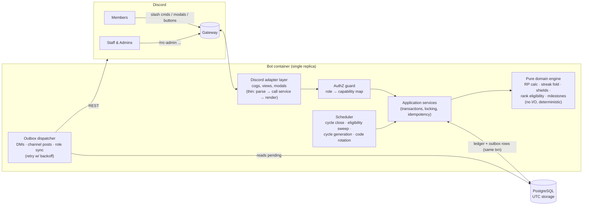
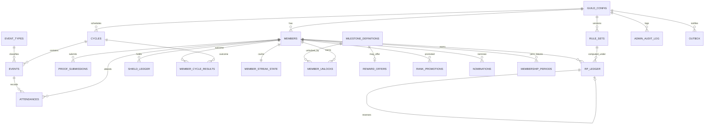
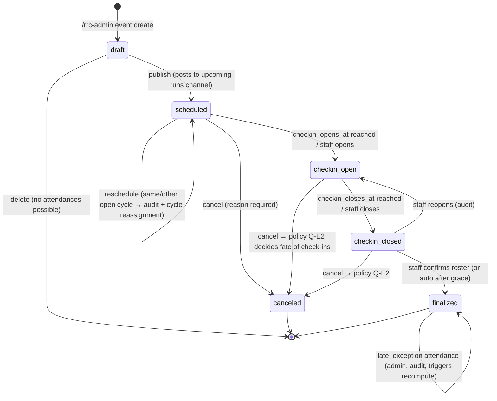
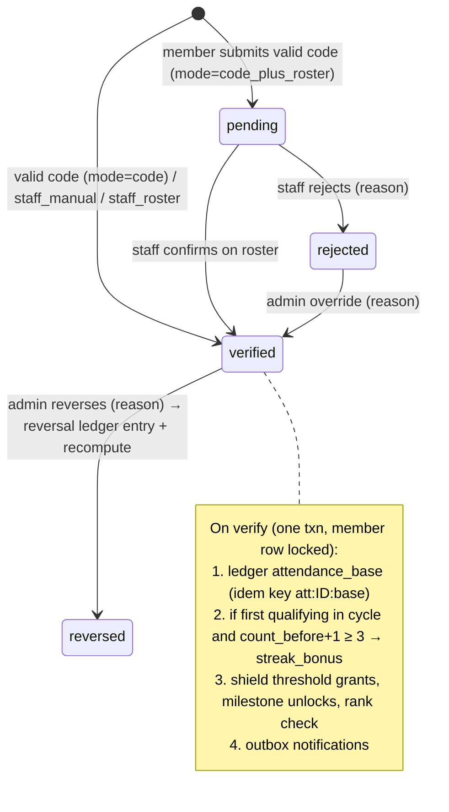
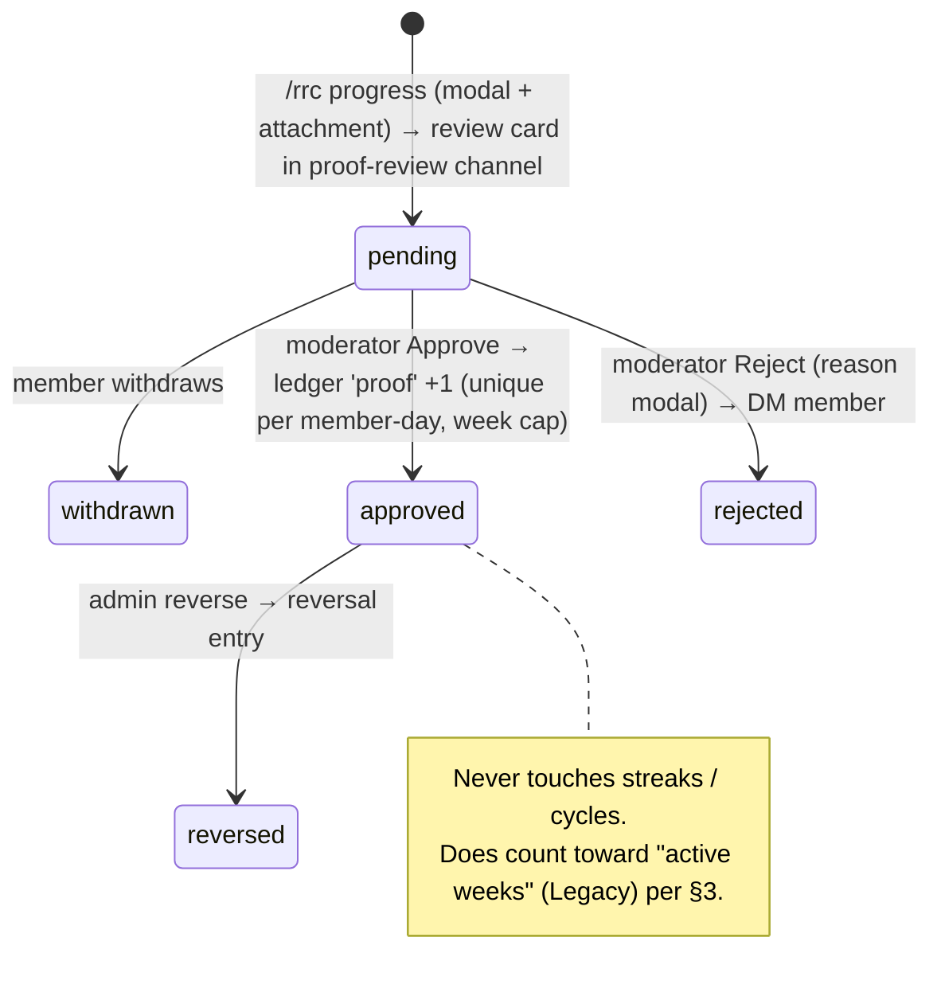
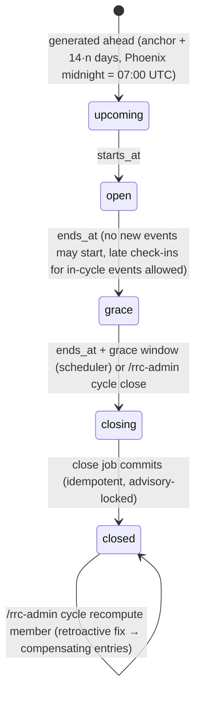
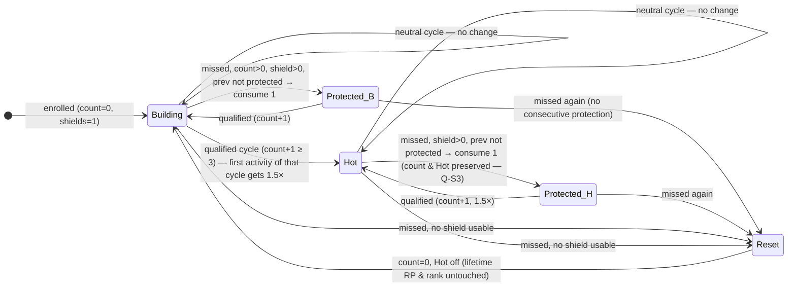
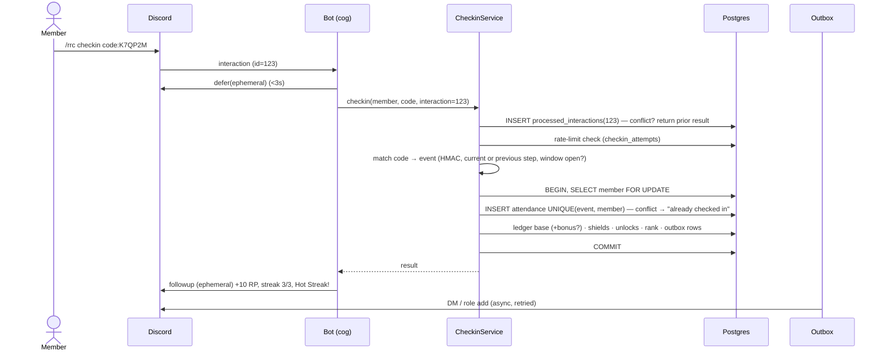

# RRC Discord Bot — Implementation Plan (for approval)

Status: **APPROVED 2026-10-27.** All §8-A recommended defaults accepted; §8-B launch values remain PROPOSED until confirmed.
Source: *Gamification, Lifetime Recognition & Discord Automation — Leadership review v1.0 (Oct 26, 2026)*.

Section references (§N) point to that document.

---

## 0. Guiding principles

| Principle | How the design enforces it |
|---|---|
| Recognition first, never over-promise rewards | Every milestone and offer has an explicit `status`. The bot only shows offer terms or redemption details when the offer is `live`, meaning an admin has approved it with terms. All §6 offers start as `proposed`, `partner_pending` or `future`. |
| Scoring lives on the server | All RP, streak and shield math runs in a pure domain layer backed by Postgres. Discord only collects input and shows output. Codes are validated server-side. |
| Immutable money-like records | `rp_ledger`, `shield_ledger`, `admin_audit_log`, `member_unlocks` and `rank_promotions` are append-only, enforced by DB triggers that reject `UPDATE`/`DELETE`. Mistakes are fixed with compensating entries. |
| Idempotency everywhere | Every RP-producing action has a deterministic `idempotency_key` with a `UNIQUE` constraint. Discord interaction IDs are deduped. Cycle-close jobs are keyed per cycle. |
| Rules can change without rewriting history | Scoring config is a versioned `rule_set`. Each ledger row records the rule-set version and the inputs used to compute it. Events snapshot their base RP when created. |
| Time | Everything is stored in UTC (`timestamptz`) and displayed in `America/Phoenix`, which is UTC−7 all year with no DST. Cycle boundaries are explicit UTC instants. |
| Least privilege | Six bot permissions, no Administrator, one privileged intent (Server Members), no Message Content intent, and in-bot role checks on every admin action. |
| No secrets in code | Tokens come only from environment or secret manager. `.env` is gitignored and `.env.example` holds placeholders. A CI secret scan runs on every push. |

---

## 1. Architecture

### 1.1 Stack (per §9 recommendation)

- **Python 3.12**, **discord.py 2.x** (slash commands, modals, persistent button views)
- **PostgreSQL 16**, **SQLAlchemy 2.0 (async, asyncpg)**, **Alembic** migrations
- **pydantic-settings** for env config and **pydantic** for validating rule-set JSON
- **pytest + pytest-asyncio**. Integration tests run against real Postgres (Docker Compose locally, a service container in CI).
- **ruff** (lint/format), **mypy** (types), and a **GitHub Actions** CI pipeline
- A single always-on container (the Discord gateway needs a persistent websocket) plus managed Postgres

### 1.2 Component diagram



**Why use an outbox?** Database commits and Discord API calls can't be in one transaction. Services write the RP change and a matching row in the `outbox` table, which holds pending notifications and role changes, in the **same** DB transaction. A dispatcher then delivers DMs, posts and role changes with retries and a dedupe key. If Discord fails, no score is lost. If the bot crashes, no notification is sent twice.

### 1.3 Repository layout (planned)

```
rrc_bot/
  config.py            # pydantic-settings; reads env only
  domain/              # PURE: no discord, no sqlalchemy
    rules.py           # RuleSet model (validated), rounding
    rp.py              # base/bonus computation
    streaks.py         # cycle fold → outcomes, bonuses, shield use
    shields.py         # grant thresholds, cap, consecutive rule
    ranks.py           # eligibility (RP, tenure, rolling-52w, active weeks)
    milestones.py
    timeutil.py        # Phoenix display, week keys, cycle math
  db/
    models.py
    repositories/
  services/            # orchestration, transactions, locks, outbox writes
    checkin.py events.py proofs.py ledger.py cycles.py
    recompute.py ranks.py rewards.py nominations.py audit.py
  bot/
    client.py          # intents, sync, persistent views
    authz.py
    cogs/member.py cogs/admin_*.py
    views/ modals/ render.py
  scheduler/jobs.py
  outbox/dispatcher.py
migrations/            # alembic
config/rules.default.yaml   # seeded values, all marked PROPOSED
tests/ unit/ integration/ edge_cases/
docker-compose.yml  Dockerfile  .env.example  README.md  docs/
```

### 1.4 Concurrency and race safety

- Every write that touches RP, shields or streaks for a member runs in one transaction that first takes `SELECT … FROM members WHERE id=$1 FOR UPDATE`. That serializes all writes for one member and leaves other members unaffected.
- `members.lifetime_rp` is a **cache**. It is updated in the same transaction as the ledger insert, and each ledger row stores `balance_after`. A nightly integrity job checks `lifetime_rp = SUM(rp_ledger.amount)` and alerts `#rrc-admin-log` on drift.
- Unique constraints are the final safety net (duplicate attendance, proof-per-day, unlock-once, shield-per-threshold, bonus-per-cycle). On a constraint violation the service returns the existing result, which makes retries idempotent.
- Scheduler jobs take a Postgres advisory lock (`pg_try_advisory_lock(job_key)`), so even an accidental second replica cannot double-close a cycle.

### 1.5 Interaction handling

- Every command that touches the DB calls `defer(ephemeral=True)` within Discord's 3-second deadline, then sends a follow-up (allowed for up to 15 minutes).
- `processed_interactions(interaction_id PK)` blocks a replayed or double-clicked interaction from running twice. The idempotency keys still protect cases where two *different* interactions request the same thing.
- Responses that include personal records are **ephemeral** by default (§8).
- Approve and Reject buttons on proof review cards use persistent views (`custom_id` = `proof:{id}:approve`), so they keep working after restarts.

---

## 2. Database schema

All timestamps are `timestamptz` (UTC). Discord snowflakes are `bigint`. Tables marked **(append-only)** have a trigger that raises an error on `UPDATE`/`DELETE`.

### 2.1 Entity-relationship overview



### 2.2 Tables (logical DDL)

```sql
-- Configuration -------------------------------------------------------------
guild_config (
  guild_id            bigint PRIMARY KEY,
  display_tz          text NOT NULL DEFAULT 'America/Phoenix',
  cycle_anchor_utc    timestamptz NOT NULL,      -- start of cycle #0 (a flagship-aligned Phoenix midnight)
  channel_ids         jsonb NOT NULL,            -- start_here, announcements, upcoming_runs, progress,
                                                 -- spotlights, rewards, admin_log, proof_review
  role_ids            jsonb NOT NULL,            -- initiate, relentless, legacy, hot_streak,
                                                 -- rrc_admin, rrc_staff, rrc_moderator, rrc_partnerships
  active_rule_set_id  bigint REFERENCES rule_sets,
  updated_at          timestamptz NOT NULL
)

rule_sets (                                       -- (append-only once status='active')
  id bigserial PK, guild_id bigint, version int,
  status       text CHECK (status IN ('draft','active','retired')),
  config       jsonb NOT NULL,   -- validated pydantic RuleSet: rp rates, multiplier, rounding,
                                 -- activation_cycles, shield policy, rank criteria, proof caps,
                                 -- late-checkin windows, cycle_length_days(=14)
  label        text,             -- e.g. 'PROPOSED v1 (pilot)'
  effective_from timestamptz, created_by bigint, approved_by bigint, created_at timestamptz,
  UNIQUE (guild_id, version)
)

event_types (
  id bigserial PK, guild_id bigint, key text,     -- flagship | popup_run | workout | challenge
  name text, default_base_rp int CHECK (default_base_rp >= 0),
  allowed_base_rp int[],                           -- e.g. {3,5} for pop-ups (§2)
  streak_qualifying bool NOT NULL, in_person bool NOT NULL, active bool,
  UNIQUE (guild_id, key)
)

-- Members --------------------------------------------------------------------
members (
  id bigserial PK, guild_id bigint, discord_user_id bigint,
  enrolled_at   timestamptz NOT NULL,             -- tenure clock for rank eligibility
  status        text CHECK (status IN ('active','left','anonymized')),
  lifetime_rp   int NOT NULL DEFAULT 0 CHECK (lifetime_rp >= 0),   -- cache of SUM(ledger)
  current_rank  text NOT NULL DEFAULT 'initiate',
  shield_balance int NOT NULL DEFAULT 0 CHECK (shield_balance BETWEEN 0 AND 10), -- cache
  consents      jsonb NOT NULL DEFAULT '{}',      -- publish_name, publish_photo, dm_notifications
  created_at timestamptz, updated_at timestamptz,
  UNIQUE (guild_id, discord_user_id)
)

membership_periods (member_id FK, joined_at timestamptz, left_at timestamptz NULL)

-- Cycles & events ------------------------------------------------------------
cycles (
  id bigserial PK, guild_id bigint, seq int,
  starts_at timestamptz, ends_at timestamptz,     -- half-open [starts_at, ends_at), 14 days
  status text CHECK (status IN ('upcoming','open','grace','closing','closed')),
  is_neutral bool NULL,                           -- set at close: true when zero qualifying events (Q-C1)
  closed_at timestamptz, closed_by bigint NULL,   -- NULL = scheduler
  UNIQUE (guild_id, seq),
  EXCLUDE USING gist (guild_id WITH =, tstzrange(starts_at, ends_at) WITH &&)
)

events (
  id bigserial PK, guild_id bigint, event_type_id FK, cycle_id FK,
  title text, location text,
  starts_at timestamptz, ends_at timestamptz,
  base_rp int NOT NULL,                           -- SNAPSHOT at creation; never recomputed
  streak_qualifying bool NOT NULL,                -- SNAPSHOT
  activity_group_key text NULL,                   -- events sharing a key count once (pop-up + challenge, §2)
  checkin_opens_at timestamptz, checkin_closes_at timestamptz,
  verification_mode text,                         -- 'code' | 'code_plus_roster' | 'staff_only'
  code_secret bytea NOT NULL,                     -- server-side HMAC key for rotating codes
  code_period_s int NOT NULL DEFAULT 60,
  status text CHECK (status IN ('draft','scheduled','checkin_open','checkin_closed',
                                'finalized','canceled')),
  cancel_reason text, created_by bigint, version int NOT NULL DEFAULT 1, -- optimistic locking
  created_at timestamptz, updated_at timestamptz
)

attendances (
  id bigserial PK, event_id FK, member_id FK,
  status text CHECK (status IN ('pending','verified','rejected','reversed')),
  method text CHECK (method IN ('code','staff_roster','staff_manual','late_exception')),
  checked_in_at timestamptz, verified_at timestamptz, verified_by bigint,
  is_late bool NOT NULL DEFAULT false, reason text,
  source_interaction_id bigint,
  UNIQUE (event_id, member_id)                    -- idempotent check-in
)
-- plus: unique (member_id, activity_group_key) via a denormalized column + partial index

checkin_attempts (id, member_id, event_id NULL, attempted_at, success bool)   -- rate limiting

-- Proof of progress ----------------------------------------------------------
proof_submissions (
  id bigserial PK, member_id FK,
  activity_date date NOT NULL,                    -- Phoenix-local calendar date
  note text NOT NULL CHECK (length(note) >= 20),  -- "meaningful content" floor (configurable)
  review_channel_id bigint, review_message_id bigint,   -- re-uploaded attachment lives here
  status text CHECK (status IN ('pending','approved','rejected','reversed','withdrawn')),
  reviewed_by bigint, reviewed_at timestamptz, review_reason text,
  source_interaction_id bigint UNIQUE, submitted_at timestamptz
)
CREATE UNIQUE INDEX one_approved_proof_per_day
  ON proof_submissions (member_id, activity_date) WHERE status = 'approved';

-- Ledgers (append-only) -----------------------------------------------------
rp_ledger (
  id bigserial PK, guild_id bigint, member_id FK,
  entry_type text CHECK (entry_type IN ('attendance_base','streak_bonus','streak_bonus_correction',
                                        'proof','manual_adjustment','reversal')),
  amount int NOT NULL CHECK (amount <> 0),
  balance_after int NOT NULL CHECK (balance_after >= 0),
  source_type text, source_id bigint, cycle_id bigint NULL,
  rule_set_id FK NOT NULL,
  calc jsonb NOT NULL,              -- {"base":5,"multiplier":1.5,"rounding":"half_up","total":8}
  reverses_entry_id bigint NULL UNIQUE REFERENCES rp_ledger,   -- reverse at most once
  idempotency_key text NOT NULL UNIQUE,  -- e.g. 'att:812:base', 'bonus:m44:c17:v1', 'proof:93'
  reason text, actor_id bigint NULL,     -- NULL = system
  created_at timestamptz NOT NULL
)

shield_ledger (
  id bigserial PK, member_id FK,
  kind text CHECK (kind IN ('enrollment_grant','rp_threshold_grant','rp_threshold_forfeit_at_cap',
                            'consumed','consumption_refund','admin_grant','admin_revoke')),
  delta int CHECK (delta IN (-1,0,1)), balance_after int CHECK (balance_after >= 0),
  rp_threshold int NULL, cycle_id bigint NULL,
  idempotency_key text UNIQUE, reason text, actor_id bigint NULL, created_at timestamptz
)
CREATE UNIQUE INDEX shield_once_per_threshold ON shield_ledger (member_id, rp_threshold)
  WHERE kind IN ('rp_threshold_grant','rp_threshold_forfeit_at_cap');

-- Streak projections (recomputable, changes audited) ------------------------
member_cycle_results (
  member_id FK, cycle_id FK, PRIMARY KEY (member_id, cycle_id),
  outcome text CHECK (outcome IN ('qualified','protected','missed','neutral','not_enrolled')),
  count_before int, count_after int, hot_after bool,
  bonus_attendance_id bigint NULL, computed_at timestamptz, engine_version int
)
member_streak_state (member_id PK, count int, hot bool, last_closed_cycle_id bigint,
                     last_cycle_protected bool, updated_at timestamptz)

-- Recognition ----------------------------------------------------------------
milestone_definitions (
  id bigserial PK, guild_id bigint, key text, threshold_rp int,
  title text, description text,
  kind text CHECK (kind IN ('recognition','rank_gate','offer')),
  status text CHECK (status IN ('launch','proposed','partner_pending','future','retired')),
  member_visible bool NOT NULL DEFAULT false,
  UNIQUE (guild_id, key)
)
member_unlocks (id, member_id, milestone_id, unlocked_at, rp_at_unlock, rule_set_id,
                UNIQUE (member_id, milestone_id))                       -- (append-only)
rank_promotions (id, member_id, from_rank, to_rank, promoted_at, criteria_snapshot jsonb,
                 actor_id NULL, UNIQUE (member_id, to_rank))             -- (append-only)
reward_offers (
  id, guild_id, milestone_id FK, partner_name, title, terms text, redemption_instructions text,
  status text CHECK (status IN ('draft','approved','live','paused','expired')),
  starts_at, ends_at, per_member_limit int, total_limit int, approved_by bigint, approved_at
)   -- members only ever see rows where status='live' AND now() within [starts_at, ends_at)
nominations (
  id, guild_id, nominator_member_id, nominee_member_id, category, story text,
  status text CHECK (status IN ('submitted','awaiting_consent','consented','declined',
                                'approved','published','rejected')),
  consent_name bool, consent_photo bool, consent_at timestamptz,
  reviewed_by bigint, published_message_id bigint, created_at
)

-- Ops ------------------------------------------------------------------------
admin_audit_log (id, guild_id, actor_id, actor_role_ids bigint[], action text,
                 target_type text, target_id bigint, reason text,
                 before jsonb, after jsonb, interaction_id bigint, created_at)  -- (append-only)
processed_interactions (interaction_id bigint PK, member_id, command, created_at)
outbox (id, guild_id, kind text CHECK (kind IN ('dm','channel_post','role_add','role_remove')),
        dedupe_key text UNIQUE, payload jsonb, status, attempts int, next_attempt_at, last_error,
        created_at, sent_at)
job_runs (id, job_name, scope_key, status, started_at, finished_at, details jsonb,
          UNIQUE (job_name, scope_key))       -- e.g. ('cycle_close','cycle:17')
```

### 2.3 Rule-set config (seeded; every value labeled PROPOSED)

```yaml
label: "PROPOSED v1 — pilot only"
cycle_length_days: 14
rp:
  flagship: 10
  popup_allowed: [3, 5]
  proof_per_day: 1
  proof_week_cap: 7          # Phoenix Mon–Sun week
streak:
  activation_cycles: 3
  multiplier: 1.5
  rounding: half_up          # 4.5→5, 7.5→8, 15.0→15
  bonus_applies_to: first_qualifying_activity_per_cycle
  late_checkin_grace_hours: 24
shields:
  enrollment_grant: 1
  grant_every_rp: 100
  max_balance: 2
  auto_consume: true
  allow_consecutive: false
ranks:
  relentless: { min_rp: 150, min_weeks_enrolled: 12, min_inperson: 4 }
  legacy:     { min_rp: 700, min_weeks_enrolled: 52, min_inperson_in_52w: 18, min_active_weeks: 40 }
```

---

## 3. State diagrams

### 3.1 Event lifecycle



### 3.2 Attendance lifecycle



### 3.3 Proof-of-progress lifecycle



### 3.4 Cycle lifecycle



### 3.5 Per-member streak engine (evaluated at each cycle close; pure fold)



**Domain algorithm (pure function, the single source of truth):**

```
fold(member, cycles[0..n], facts) -> [CycleResult]
  state = {count: 0, hot: false, prev_protected: false}
  for c in cycles (chronological):
    if member not enrolled before c.ends_at:            -> not_enrolled
    quals = verified, streak-qualifying, in-person attendances with event.starts_at in c,
            de-duplicated by activity_group_key, sorted by (event.starts_at, event.id)
    shields = shield balance as of c.ends_at (grants earned during c count)
    if quals:      count += 1; hot = count >= activation; prev_protected = false
                   bonus_target = quals[0] if hot else None      -> qualified
    elif c.is_neutral:                                           -> neutral   (state unchanged)
    elif auto_consume and count > 0 and shields > 0 and not prev_protected:
                   consume 1; prev_protected = true              -> protected (count unchanged)
    else:          count = 0; hot = false; prev_protected = false -> missed
```

**Live awarding vs. reconciliation.** In an open cycle the bonus is awarded right away, when the first qualifying attendance is verified, so members get instant feedback. A **reconciler** reruns `fold` whenever facts change: an out-of-order verification, a late exception, a reversal, a reschedule or a cancellation. It compares the expected bonus and shield usage per cycle with what the ledger actually holds, then posts only the **difference** as `streak_bonus_correction` or `consumption_refund` entries. Their idempotency keys include a recompute generation number. Each run produces the same corrections from the same facts, so no bonus is ever paid twice and historic rows are never edited.

### 3.6 Check-in sequence



---

## 4. Discord surface

### 4.1 Member commands (§8). All ephemeral unless noted.

| Command | Behavior |
|---|---|
| `/rrc join` *(proposed, Q-M1)* | Enroll and accept the rules and privacy notice. Grants the Initiate role and 1 shield. |
| `/rrc profile` | Shows lifetime RP, rank, next milestone and **pending eligibility** (e.g. "700 RP ✔ · 52 weeks: 31/52 · in-person 14/18 · active weeks 27/40"), streak count, Hot status, shields and unlocks. |
| `/rrc events` | Lists upcoming qualifying activities and the current cycle deadline, in Phoenix time. |
| `/rrc checkin [code]` | With a code, checks in directly. Without one, opens a select menu of currently open events, then a code modal. |
| `/rrc progress` | Opens a modal (activity date, description) with an optional image attachment, and creates a review card for moderators. |
| `/rrc rewards` | Shows earned unlocks. Terms and redemption details appear **only for `live` offers**. Everything else shows "Recognition unlocked; offer not yet available" or is hidden (L6). |
| `/rrc nominate` | Opens a nomination modal. The nominee gets a DM asking for consent before anything is published. |
| `/rrc help` | Explains rules, disputes and how to participate, generated from the active rule set so it never goes stale. |
| `/rrc mydata` *(proposed)* | Exports your own records as JSON (ephemeral file). |

### 4.2 Admin commands (`/rrc-admin …`)

These are hidden from regular members via `default_member_permissions`, and the bot **also** checks capabilities on every call.

| Group | Subcommands | Capability |
|---|---|---|
| `event` | `create`, `edit`, `reschedule`, `cancel`, `publish`, `open`, `close`, `finalize`, `code` (shows rotating code with Refresh button), `roster`, `list` | staff (create/cancel: admin?) Q-A1 |
| `attendance` | `add` (manual or late exception, reason required), `verify`, `reject`, `reverse` | staff / admin for reverse |
| `proof` | `queue`, `reverse` (approve/reject happen via buttons) | moderator / admin for reverse |
| `rp` | `adjust` (±, reason required), `reverse <entry>`, `history <member>` | admin |
| `cycle` | `list`, `generate`, `preview-close`, `close`, `recompute <member|all>` | admin |
| `member` | `lookup`, `export`, `anonymize`, `shield grant/revoke` | admin |
| `rules` | `show`, `draft` (upload YAML), `diff`, `activate` | admin (two-person rule? Q-A2) |
| `milestone` / `offer` | `list`, `set-status`, `offer create/approve/publish/pause/expire` | partnerships + admin |
| `nominations` | `queue`, `approve`, `publish` | moderator |
| `setup` | Map channels and roles, set cycle anchor, run a self-check of bot permissions and role hierarchy | admin |

**Capability map:** each internal role maps to configured Discord role IDs. `rrc_admin` holds all capabilities. `rrc_staff` covers events and attendance. `rrc_moderator` covers proofs and nominations. `rrc_partnerships` covers offers. Every admin action writes an `admin_audit_log` row (before/after JSON) and posts a summary line to `#rrc-admin-log` through the outbox.

---

## 5. Section 10 edge cases → design → tests

| # | Edge case | Design handling | Test(s) |
|---|---|---|---|
| 1 | Late check-ins | Code check-ins are accepted only inside `[checkin_opens_at, checkin_closes_at]`. After that, staff add a `late_exception` attendance with a reason. If the event's cycle is already closed, this triggers a member recompute. | code after window rejected; late_exception inside grace counts toward cycle; late_exception after close triggers bonus and shield corrections |
| 2 | Canceled events | Canceling before check-in has no RP effect. Canceling after check-in follows Q-E2. Neutrality is recomputed if no qualifying event remains. | cancel with/without attendances; cancel only event → cycle neutral |
| 3 | Rescheduling | Allowed among open/upcoming cycles. Moving across cycles with verified attendance needs admin and recomputes both cycles. Moving into a closed cycle is blocked. | same cycle; cross cycle; into closed → error |
| 4 | Cycle with no qualifying event | `is_neutral` → no increment, reset or shield use (decided, Q-C1) | neutral cycle between qualified ones keeps count |
| 5 | Two events in one cycle | Both earn base RP. Only the earliest by event start gets 1.5×. The streak counts once. A shared `activity_group_key` counts once. | flagship + pop-up; pop-up + challenge same group |
| 6 | Third-cycle activation | Bonus goes on the first qualifying activity of cycle 3 | Q,Q,Q → bonus in c3 only on first activity; Q,Q,S,Q → bonus at 4th cycle |
| 7 | Rounding | half_up on integer arithmetic: `(base*3 + 1)//2` | 3→5, 5→8, 10→15, 0→0, configurable mode |
| 8 | Shield cap / consecutive | Cap 2: a grant at cap is recorded as a forfeit and is never re-earned. Two consecutive misses → reset even with shields. | grant at cap; reversal below 100 and back → no regrant; S,S → reset |
| 9 | Retroactive admin adjustments | Compensating entries plus reconciler diff. History is never rewritten. | reverse a bonus-bearing attendance → bonus moves to next activity in that cycle |
| 10 | RP threshold before time requirement | Rank stays put. Profile shows pending criteria. A daily eligibility sweep promotes members when time requirements mature. | 150 RP at week 3 → promoted at week 12 via sweep |
| 11 | 18 in rolling 52 weeks | Sliding window over in-person verified timestamps (364 days), per Q-K1 | 18 spread over 53 weeks fails; 18 within 52 passes |
| 12 | 40 active weeks | Distinct Phoenix ISO weeks with in-person or approved proof, per Q-K2 | proof-only weeks count; same-week duplicates count once |
| 13 | Leave/rejoin server | Member row kept. `membership_periods` records the gap. Roles are re-applied on rejoin. Enrollment date and RP are preserved (Q-M2). | leave → status left; rejoin → roles restored, RP same |
| 14 | Duplicated interactions | `processed_interactions` plus unique constraints | same interaction ×2; two interactions same event; double-click approve |
| 15 | Rule changes without rewriting history | Versioned rule sets. Events snapshot base RP. Ledger stores `rule_set_id` and `calc`. | change flagship 10→12: old entries unchanged, new events use 12 |
| 16 | Race-condition-safe RP | Member row lock, unique keys and an integrity job | 50 concurrent check-ins/approvals → exact balance, no duplicate shields or unlocks |

There are also property-based tests (Hypothesis) on the fold: for random attendance sequences, the result is deterministic and independent of insertion order, there is at most one bonus per member-cycle, and the shield balance stays within `[0, cap]`.

---

## 6. Discord Developer Portal setup (exact steps & permissions)

1. **Create the application.** Go to <https://discord.com/developers/applications>, choose **New Application**, name it (e.g. "RRC Bot") and accept the terms. Under **General Information**, copy the **Application ID** into `DISCORD_APPLICATION_ID`. It is not secret. The Public Key is **not** needed because we use the gateway, not an HTTP interactions endpoint.
2. **Installation tab.** Set **Installation Contexts** to **Guild Install only** (uncheck User Install). Set **Install Link** to *None*, so we share the generated URL ourselves.
3. **Bot tab.**
   - **Reset Token** and copy it **once** straight into your secret manager or local `.env` as `DISCORD_TOKEN`. Never paste it into code, chat, issues or commits. If it leaks, reset it right away.
   - **Public Bot: OFF**, so only the app owner can add it to servers.
   - **Requires OAuth2 Code Grant: OFF.**
   - **Privileged Gateway Intents:** Presence **OFF** · **Server Members ON** (to detect leave/rejoin and re-apply rank roles) · Message Content **OFF** (we never read messages, per §9).
4. **OAuth2 → URL Generator.** Scopes: `bot`, `applications.commands`. Bot permissions (and only these):

   | Permission | Why | Bit |
   |---|---|---|
   | View Channels | see the configured channels | 1<<10 |
   | Send Messages | announcements, review cards, admin log | 1<<11 |
   | Embed Links | rich profile, event and review embeds | 1<<14 |
   | Attach Files | re-upload proof images to the review channel; JSON exports | 1<<15 |
   | Read Message History | edit or fetch its own review cards after restart | 1<<16 |
   | Manage Roles | assign Initiate/Relentless/Legacy/Hot Streak | 1<<28 |

   **Permission integer: `268553216`.** Not requested: Administrator, Manage Server, Manage Messages, Mention Everyone, Message Content. *Optional later:* Create Events (1<<44), only if we mirror RRC events as Discord Scheduled Events.
5. **Invite to the private test server first** (Phase 5 pilot). Open the generated URL, pick the server, then **Authorize**.
6. **Server configuration.**
   - **Roles:** create `Initiate`, `Relentless`, `Legacy`, `Hot Streak` and staff roles (`RRC Admin`, `RRC Staff`, `RRC Moderator`, `RRC Partnerships`). Drag the **bot's role above** the four rank/streak roles; Discord only lets a bot manage roles below its own. `/rrc-admin setup` checks this.
   - **Channels:** `#rrc-admin-log` and `#rrc-proof-review` deny View Channel to @everyone and allow it for staff roles and the bot. Grant the bot Send/Embed/Attach in `#announcements`, `#upcoming-runs`, `#community-spotlights` and `#rewards`.
   - **Server Settings → Integrations → RRC Bot:** restrict `/rrc-admin` to staff roles. This is defense in depth; the bot re-checks roles regardless.
7. **Collect IDs.** In Discord, go to User Settings → Advanced → **Developer Mode ON**, then right-click to copy the Guild ID, role IDs and channel IDs. Enter them via `/rrc-admin setup` or env bootstrap.
8. **Command sync.** In dev, commands sync to the single guild (`DISCORD_GUILD_ID`) for instant updates. In production, commands are guild-scoped too, since this is a single-server bot.
9. **Token rotation runbook** (in the README): reset in the portal, update the secret, restart the container, then verify on the audit channel.

---

## 7. Phased delivery (each phase = its own PR, green CI, demoable)

| Phase | Scope | Acceptance |
|---|---|---|
| **0 Scaffold** | Repo layout, config (env only), Docker Compose (Postgres 16), Dockerfile, Alembic baseline, CI (ruff, mypy, pytest, secret scan), `.env.example`, README skeleton | `docker compose up db && pytest` green; no secrets in repo |
| **1 Rules + data** | Full schema and migrations, append-only triggers, rule-set model plus seed (PROPOSED), pure domain engine, edge-case unit and property tests | Deterministic RP and streak calculations pass all §10 cases |
| **2 Attendance** | Event CRUD, rotating codes, `/rrc checkin`, staff roster/manual/late, `/rrc profile`, `/rrc events`, ledger service with locks and idempotency, audit log, outbox | One verified attendance creates exactly one base ledger entry under concurrency |
| **3 Cycles** | Cycle generation, scheduler, close job, shields, Hot Streak role, reconciler/recompute, proof flow with moderator buttons | Close, reset, protection and correction behavior is correct across replayed scenarios |
| **4 Recognition** | Rank engine plus daily sweep, rank roles, milestones and unlock notifications, offers (status-gated), `/rrc rewards`, nominations with consent, `/rrc help`, data export/anonymize | Unlocks issued once; eligibility enforced; non-live offers never shown as live |
| **5 Pilot** | Deployment guide (Fly.io/Railway/VPS plus managed Postgres), backups/restore drill, monitoring, admin runbook, pilot checklist | Two full cycles validated on a private server with 10–20 volunteers |

---

## 8. Open policy questions

### Decisions log

| Date | ID | Decision |
|---|---|---|
| 2026-10-27 | Q-V1 | **Code + staff roster.** A valid rotating code creates a *pending* attendance. RP posts only when staff confirm the roster. `verification_mode` stays per-event in the schema, but the default and pilot value is `code_plus_roster`. |
| 2026-10-27 | Q-M1 | **`/rrc join` starts membership.** The member accepts the rules and privacy notice, which sets `enrolled_at` (the tenure clock) and grants the enrollment shield and Initiate role. |
| 2026-10-27 | Q-C1 | **Zero-event cycles are neutral/frozen.** No increment, no reset, no shield use. |
| 2026-10-27 | Q-C3 | **Auto-close after grace, with a preview.** The scheduler closes cycles 24h after `ends_at` and posts a preview to `#rrc-admin-log` 2h before. Admins can force-close or recompute. |
| 2026-10-27 | All other §8-A | **Recommended defaults accepted as written** (C2, C4, S1–S5, M2, M3, E1–E4, P1, P2, K1–K4, A1, A2, H1). Still needed as *configuration*, not code: the first flagship date (cycle anchor, C4) and the people holding each staff role (A1). |
| 2026-10-27 | L7 | **Hosting: Google Cloud e2-micro** (us-west1) running the bot and PostgreSQL via Docker Compose, with nightly verified backups to Cloud Storage. Accepted cost of about $3.65/month for the public IPv4 address. The Discord token is stored in **Secret Manager**, readable only by a dedicated least-privilege VM service account. Runbooks: `docs/DEPLOY_GCP.md` (manual) and `docs/LAPTOP_SETUP.md` (Claude on the owner's Windows laptop). |
| 2026-10-27 | Impl | **Phase 1–2 built (v0.2.0) with these implementation choices.** (1) One active rule set per guild is enforced by a partial unique index on `rule_sets` instead of `guild_config.active_rule_set_id`, which avoids a circular foreign key. (2) Seeded event types are `flagship` (10 RP) and `popup_run` (3 or 5 RP). `workout` and `challenge` wait until their RP values are decided; a challenge held at a pop-up shares its `activity_group_key` (Q-E1). (3) Events also snapshot `in_person`. (4) Code check-in opens 30 minutes before the start and closes 30 minutes after the end; codes rotate every 60 s and the previous code is accepted; 5 wrong codes in 10 minutes pause a member's check-ins. (5) The member row lock is `FOR NO KEY UPDATE`: a concurrency test showed plain `FOR UPDATE` deadlocks with foreign-key `KEY SHARE` locks on double taps. (6) `finalize` can be re-run to confirm a check-in that raced it. (7) `/rrc-admin` defaults to Manage Server in Discord; server managers count as RRC admins so the owner can run setup. (8) Until Phase 3 closes cycles, streak counts stay 0, so no Hot Streak bonus is paid yet. |


**Blocking implementation** questions change behavior or schema; I need answers before Phase 1–3 code. **Blocking launch** questions are numbers or terms that are already configurable, so they can be decided any time before public launch. Each has my recommended default.

### A. Blocking implementation

| ID | Question | Recommended default |
|---|---|---|
| Q-V1 ✅ | **Check-in verification:** does a valid rotating code verify immediately, or create a *pending* record that staff confirm on a roster? | Configurable per event; default `code_plus_roster` for the pilot (§9: "QR alone is insufficient") |
| Q-C1 ✅ | **Zero-event cycle:** if no qualifying event is published, is the cycle neutral (no increment, no reset, no shield use) for everyone? | Yes, neutral |
| Q-C2 | Does a **neutral cycle break** the "no two consecutive protected cycles" chain (S, N, S)? | No. Neutral cycles are skipped, so S, N, S counts as consecutive → second miss resets |
| Q-C3 ✅ | **Cycle close:** automatic at deadline plus grace, or only when an admin presses close? Grace length? | Automatic after 24h grace, with `preview-close` posted to the admin log 2h before |
| Q-C4 | **Cycle boundary time:** 00:00 Phoenix on flagship-aligned dates? Which date is cycle #1? | 00:00 Phoenix; you provide the first flagship date |
| Q-S1 | Do shields get consumed when **streak count is 0** (nothing to protect)? | No. Only consume when count > 0 |
| Q-S2 | Can members **opt out** of auto-consumption (save shields)? | No for MVP |
| Q-S3 | When **Hot** and a shield protects a cycle, does Hot (1.5×) stay active? | Yes. Count preserved means Hot preserved |
| Q-S4 | Shield grant **while at cap**: forfeited permanently or deferred until below cap? | Forfeited (recorded); never re-earned for that threshold |
| Q-S5 | Do **manual adjustments** and **proof RP** count toward 100-RP shield thresholds and milestones? | Yes. All lifetime RP counts |
| Q-M1 ✅ | **Enrollment:** what starts membership (and the 12/52-week clock)? `/rrc join`, joining the server, or staff approval? | `/rrc join` with rules/privacy acceptance |
| Q-M2 | **Leave/rejoin:** keep the original enrollment date and RP? Does the streak keep running while absent? | Keep everything; missed cycles while away count as missed |
| Q-M3 | **Data deletion request:** anonymize (keep ledger totals for audit) or hard-delete? | Anonymize: strip Discord ID and text, keep numeric ledger |
| Q-E1 | "Same pop-up cannot be counted as a separate challenge twice": is a challenge held at a pop-up **one activity** (one RP award)? | Yes, via `activity_group_key` |
| Q-E2 | **Event canceled after people checked in** (e.g. weather mid-run): keep or void attendance and RP? | Keep by default; admin may void with reason |
| Q-E3 | Can an event **span a cycle boundary**? Which cycle owns it? | Owned by the cycle containing `starts_at` |
| Q-E4 | **Late-exception limit:** how long after an event can staff add attendance, and who? | Staff: up to grace end; admin: up to 14 days, reason required |
| Q-P1 | **Proof "qualifying day":** activity date (backdating allowed?) or submission date? How far back? | Activity date, max 2 days back |
| Q-P2 | **Meaningful content:** minimum text, and is a photo or screenshot required? | ≥ 20 chars plus photo optional; moderator decides |
| Q-K1 | **Legacy 18-in-52-weeks:** any 52-week window ever, or the trailing 52 weeks at evaluation time? | Any window ever (eligibility is permanent once met) |
| Q-K2 | **40 active weeks:** lifetime or within the same 52-week window? Week = Phoenix Mon–Sun? | Lifetime; Phoenix ISO weeks |
| Q-K3 | Relentless "4 verified in-person activities": lifetime count? | Lifetime |
| Q-K4 | **Reversal below a threshold:** do ranks and unlocks already granted stay? | Stay (permanent); flag to admin log; explicit admin revoke only for proven error |
| Q-A1 | **Admin owners:** who holds `RRC Admin`, `Staff`, `Moderator`, `Partnerships` (§12)? Can Staff create events, or only Admin? | Staff create; Admin cancel, reverse and close |
| Q-A2 | Do rule-set changes need **two-admin approval**? | Yes, for `rules activate` and `rp adjust` above ±25 RP |
| Q-H1 | **Historical data:** import past attendance from before launch? | No. Start fresh at pilot |

### B. Blocking launch (configurable, seeded as PROPOSED)

| ID | Question (from §12) |
|---|---|
| L1 | Proof-of-progress worth 1 RP/day, max 7/week? |
| L2 | Rank thresholds: Relentless 150 RP/12 wk/4 events; Legacy 700 RP/52 wk/18 events/40 active weeks? |
| L3 | 3-cycle activation, 1.5× on the first eligible activity, round .5 up? |
| L4 | Shields: start with 1, +1 per 100 RP, cap 2, auto-use, no consecutive protection? |
| L5 | Milestone offers (15% Rejuvestix at 50, partner offers at 100/300, merch at 500) and their terms, before anything is shown as live? |
| L6 | Should not-yet-live milestones be **hidden** from members or shown as "coming soon"? (Recommendation: show the recognition title only, never terms) |
| L7 | Hosting preference and budget (Fly.io / Railway / Render / VPS; Neon / Supabase / RDS Postgres)? |
| L8 | Pilot server: is there an existing private test server, and who are the 10–20 volunteers? |
